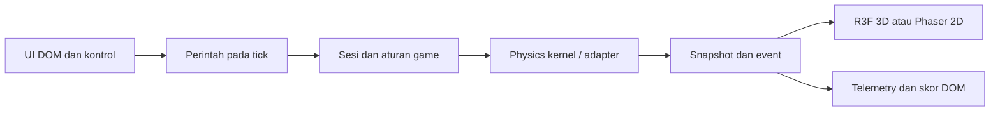

# Arsitektur awal

## Keputusan

Satu aplikasi Next.js App Router, TypeScript strict, Tailwind CSS, satu package manager (rencana npm), satu lockfile. Tidak perlu workspace monorepo. Next.js menyajikan halaman/katalog dan UI DOM. Runtime game di client dimuat per route, agar pengunjung katalog tidak mengunduh seluruh engine. Pilihan ini adalah keputusan proyek, bukan persyaratan semua library.

3D memakai Three.js melalui React Three Fiber (R3F). Rapier 3D diakses melalui adapter tipis milik proyek; pilih binding WASM stable yang sesuai setelah spike awal Fase 2. Baseline memakai Rapier langsung, tanpa `@react-three/rapier`, sehingga hanya satu pemilik loop. Wrapper bisa dipertimbangkan dengan catatan keputusan jika mengurangi kode dan tetap menjaga akses headless dan single-step. Phaser dipakai untuk render/input Rocket Landing pada fasenya; Arcade/Matter tidak otomatis diaktifkan.

[R3F](https://r3f.docs.pmnd.rs/getting-started/introduction) menyediakan renderer React untuk Three.js. Versi stable dipilih mengikuti kompatibilitas React; jangan mengikuti dokumentasi alpha secara tidak sengaja. Integrasi framework dicek terhadap [panduan Next.js](https://nextjs.org/docs/app/getting-started/installation).

## Aliran data



Kernel tidak mengimpor React, DOM, R3F, atau Phaser. Session menerjemahkan input ke perintah (aim, shoot, throttle, reset), mengelola state dan skor, serta mengonsumsi event physics. Renderer membaca snapshot dan tidak menulis transform physics. HUD menerima pembaruan rendah frekuensi (rencana 10 Hz); data frame memakai ref/buffer lokal. Hindari event bus/global store sampai aliran props dan sesi lokal tidak cukup.

## Struktur rencana, belum dibuat

```text
src/
  app/                      # halaman, layout, route /games/billiard
  components/               # navigasi, kontrol DOM, panel parameter
  games/
    billiard/               # rules, presets, scene, session
  physics/
    core/                   # unit, fixed-step, schema config
    adapters/rapier3d/      # inisialisasi WASM, world lifecycle
  lib/                      # utilitas yang benar-benar dipakai
tests/
  physics/                  # oracle analitik, integrasi headless
  e2e/                      # Playwright
public/                     # asset lokal berlisensi jelas
.agents/skills/             # skill proyek, sudah dibuat di Fase 0
docs/                       # sumber keputusan
```

Folder game berikutnya dibuat saat fasenya, bukan placeholder kosong. Tes pure function boleh berdekatan dengan modul; integrasi solver dan E2E tetap di `tests/`.

## Kontrak runtime

Kontrak minimal konseptual: `initialize(config, seed)`, `enqueue(command, tick)`, `step(dt)`, `readSnapshot()`, `reset(config, seed)`, `dispose()`. Bukan kewajiban membuat interface generik untuk semua game sekarang. Snapshot mencakup tick, waktu simulasi, pose/velocity per entity ID, status sesi, dan event. Command/config divalidasi di batas masuk, seluruh angka harus finite, satuan terdokumentasi.

State sesi: loading → ready → running ↔ paused → completed/failed; error dapat terjadi saat init/runtime. Shot Billiard punya substate aiming → moving → settling → aiming/completed. Reset membuat world dan counters kembali ke baseline; listener tidak boleh terdaftar dua kali. Mode hanya mengubah policy kontrol dan penyajian, bukan persamaan tersembunyi.

Gunakan fixed tick 1/120 s sebagai baseline Billiard, accumulator waktu render, interpolasi pose untuk tampilan. Cap delta frame 0,1 s dan maksimum 8 step/frame; jika tertinggal, buang backlog berlebih dan catat slow-simulation, bukan memakai dt besar. Tick yang dibuang tidak dianggap sudah disimulasikan. Pada tab tersembunyi/focus hilang: pause, kosongkan accumulator/input aktif; resume melalui kontrol pengguna. UI waktu dan skor berbasis simulated time/tick, bukan waktu render. Time-scale Simulation Mode mengubah laju tick, bukan ukuran dt.

## Client, lifecycle, dan deploy

Route shell boleh server-rendered; modul game memakai client boundary, dynamic import yang sesuai, loading/error boundary, lalu inisialisasi WASM setelah mount. Jangan mengakses `window` pada import server. Uji route reload dan production build untuk mendeteksi SSR/hydration/WASM asset failures.

Cleanup harus melepas listener, timer, input capture, world, dan canvas. Ikuti [pengelolaan resource Three.js](https://threejs.org/manual/pages/cleanup.html); perhatikan resource bersama agar tidak didispose saat masih dipakai. React remount dalam development tidak boleh menggandakan loop. WebGL context loss menampilkan pemulihan/reset yang aman; jika tidak didukung, shell tetap dapat dibaca.

Vercel adalah target hosting, bukan kebutuhan runtime fisika server. Tidak ada API route/backend untuk simulasi MVP. Deployment preview dijalankan pada fase rilis setelah akun/repo terhubung; status koneksi saat ini belum diverifikasi. Mulai di main thread; worker hanya setelah profil menunjukkan bottleneck. Skala kualitas grafis sebelum menurunkan akurasi fisika.

## Risiko dan respons

| Risiko | Respons awal dan gate |
| --- | --- |
| GPU HP/WASM/SSR | Spike awal Fase 2: init, render, resize, cleanup, production build dan error path |
| Tunneling bola cepat | CCD selektif, batas kecepatan, tes lintasan bantalan; jangan menutupinya dengan teleport |
| Hambatan gulir dihitung dua kali | Satu pemilik gaya; tes stopping distance dan slip/rolling |
| Bundle besar | Lazy load per game; Phaser tidak masuk fase awal; ukur build dan network |
| Scope tumbuh ke lima game sekaligus | Gate roadmap dan backlog enhancement terpisah |
| Replay berbeda | Seed/config/versi/order/tick dicatat; jangan menjanjikan bit-identik lintas versi |
